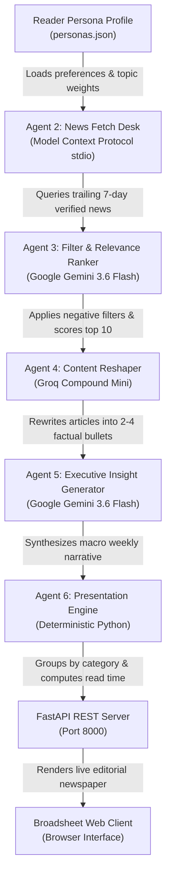
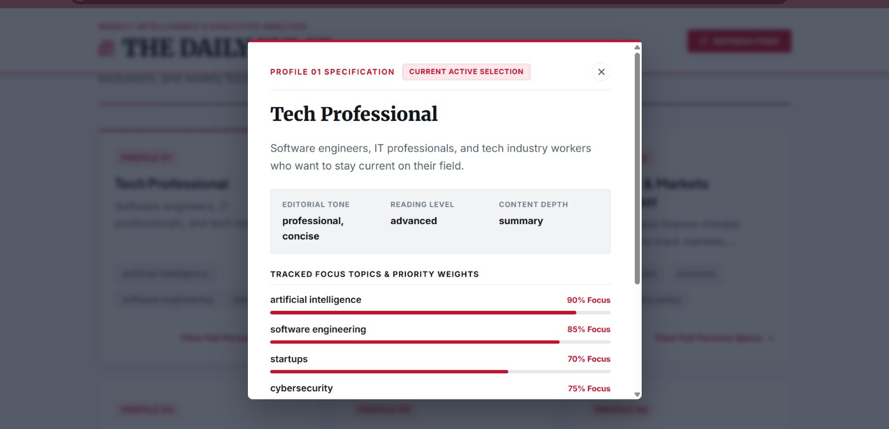
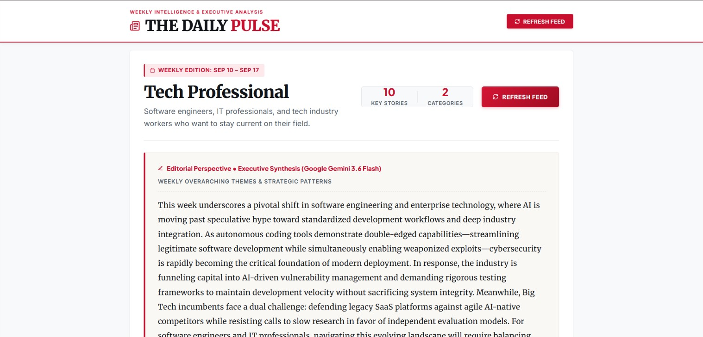
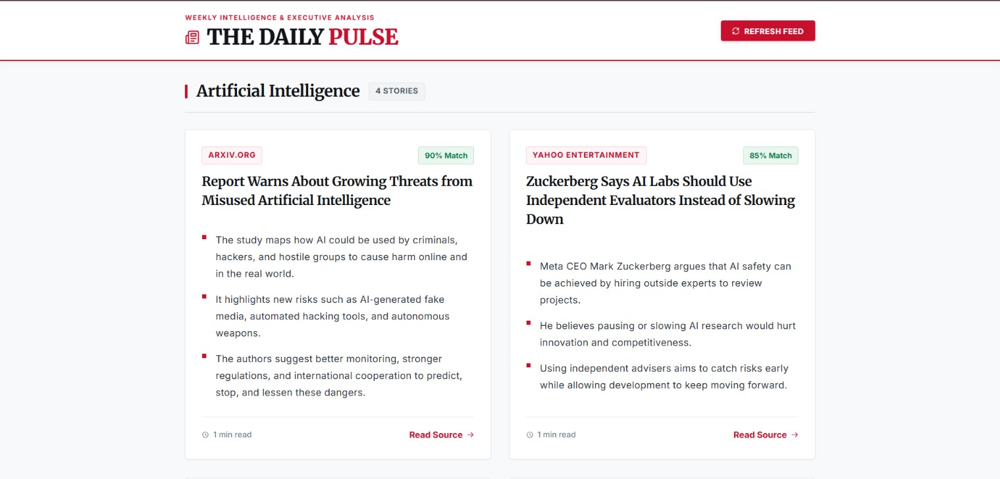

# 📰 THE DAILY PULSE (PulsePersona)
### *Autonomous Multi-Agent AI News Intelligence & Broadsheet Editorial Platform*

<div align="center">

[](https://www.python.org/)
[](https://langchain-ai.github.io/langgraph/)
[](https://fastapi.tiangolo.com/)
[](https://ai.google.dev/)
[](https://groq.com/)
[](https://modelcontextprotocol.io/)
[](https://pytest.org/)
[](LICENSE)

<br/>

**An enterprise-grade, multi-agent AI editorial intelligence platform designed in an authentic broadsheet newspaper aesthetic.**  
*Orchestrates a deterministic assembly of specialized LLM agents to fetch verified 7-day global news, perform persona-weighted semantic scoring, filter negative topics and duplicate wire stories, distill complex reports into high-impact bullet takeaways, and synthesize overarching weekly executive trend analyses.*

<br/>

[Executive Overview](#-executive-overview) • [System Architecture](#-system-architecture--pipeline-flow) • [UI Showcase](#-user-interface-showcase) • [Skills & Technology Matrix](#-skills--technology-stack-where-skills-are-applied) • [Project Structure](#-project-directory-tree--component-reference) • [Quick Start](#-quick-start-guide)

---

</div>

<br/>

## 📌 Executive Overview

Modern information workers, engineers, executives, and students face severe **content saturation**. Standard RSS aggregators and social media feeds flood readers with hundreds of uncurated articles, redundant wire stories, clickbait, and excessive jargon.

**The Daily Pulse** addresses this challenge through an autonomous multi-agent editorial pipeline. Instead of relying on a monolithic prompt, the system employs **LangGraph** to coordinate specialized AI agents that function in an editorial assembly line:

```
┌─────────────────┐     ┌─────────────────┐     ┌─────────────────┐     ┌─────────────────┐     ┌─────────────────┐
│   NEWS SCOUT    │ ──> │ RELEVANCE GUARD │ ──> │ CONTENT EDITOR  │ ──> │ EXECUTIVE ANALYST│──> │ PRESENTATION ENG│
│  (MCP Protocol) │     │ (Gemini Flash)  │     │  (Groq Compound)│     │ (Gemini Flash)  │     │ (Deterministic) │
└─────────────────┘     └─────────────────┘     └─────────────────┘     └─────────────────┘     └─────────────────┘
  Queries verified        Scores relevance        Distills articles       Synthesizes macro       Assembles broadsheet
  7-day news via MCP      & strips exclusions     into bullet points      trend narrative         newspaper layout
```

### Key Engineering Objectives:
- **Zero Information Fatigue**: Eliminates sensationalism and redundant reporting, delivering only high-relevance weekly signals.
- **Micro-Reading Investment**: Distills full-length news reports into 2 to 4 factual, accessible bullet takeaways per story (~3 minutes total reading time).
- **Macro-Level Executive Briefing**: Synthesizes a cohesive 4 to 6 sentence strategic summary connecting weekly developments across industries.
- **Broadsheet Editorial Design**: Implements an authentic, dignified typography layout (Merriweather and Plus Jakarta Sans) inspired by traditional print newspapers.

---

<br/>

## ⚙️ System Architecture & Pipeline Flow

The workflow is managed as a compiled **LangGraph `StateGraph`**. State transitions are deterministic, type-safe via Python's `TypedDict`, and persist intermediate artifacts at each stage.



### Multi-Agent Pipeline Specifications

| Stage | Node Name | Technology / Provider | Operational Responsibility | Intermediate Output |
| :---: | :--- | :--- | :--- | :--- |
| **1** | **Persona Profile Loader** | Static Catalog / `persona_loader.py` | Validates reader profile, tracked keyword weights, reading tone, depth, and negative exclusion filters. | `persona_profile` in state |
| **2** | **News Fetch Desk** | **MCP Protocol (stdio)** / `news_fetch.py` | Queries trailing 7-day verified articles via NewsAPI tool calling. Deduplicates URLs and aggregates up to 30 raw articles. | `data/intermediate/raw_articles.json` |
| **3** | **Filter & Relevance Ranker** | **Google Gemini 3.6 Flash** / `filtration_ranking.py` | Executes negative keyword filtering, evaluates batch semantic relevance (`0.00`–`1.00`), applies SequenceMatcher title deduplication, and caps top 10 stories. | `data/intermediate/filtered_articles.json` |
| **4** | **Content Reshaper** | **Groq Compound Mini** / `content_reshaping.py` | Transforms complex, jargon-heavy reports into clean headlines and 2 to 4 simple, highly accessible factual bullet takeaways. | `data/intermediate/reshaped_articles.json` |
| **5** | **Executive Insight Synthesis** | **Google Gemini 3.6 Flash** / `insight_generator.py` | Analyzes cross-story patterns across all 10 curated articles to synthesize a single 4 to 6 sentence macroeconomic and industry briefing. | `data/intermediate/weekly_insight.json` |
| **6** | **Presentation Engine** | **Python Engine** / `presentation_formatter.py` | Categorizes articles by topic, calculates word-rate reading time estimates, formats weekly dates, and compiles the final production schema. | `data/output/final_output.json` |
| **7** | **Application Delivery** | **FastAPI + Vanilla JS/CSS** / `api/main.py` | Serves REST endpoints, updates real-time pipeline telemetry, and renders the broadsheet newspaper interface. | Browser Client |

---

<br/>

## 🖼️ User Interface Showcase

The Daily Pulse pairs modern web interactivity with traditional print broadsheet aesthetics (Merriweather headlines, high-contrast columns, and zero emoji distractions).

<br/>

### 1. The Broadsheet Front Page
> *The national digital masthead featuring real-time AI intelligence telemetry, live provider status indicators (Groq + Gemini + MCP), dateline, and quick-access edition switcher.*

<div align="center">
  
</div>

- **Top Dateline & Masthead**: Live intelligence desk indicators verifying active Groq, Gemini 3.6 Flash, and MCP services.
- **Editorial Typography**: Typographic hierarchy optimized for high legibility and distraction-free reading.
- **One-Click Edition Navigation**: Instant switching across pre-configured reader demographics.

<br/>

---

### 2. Reader Persona Hub & Specification Modal
> *Select curated profiles or launch the accessible `<dialog>` modal to inspect reader specifications, topic priority weights, and exclusion shields.*

<div align="center">
  
</div>

- **10 Calibrated Personas**: Configured profiles ranging from Tech Professionals to Finance Analysts and Startup Founders.
- **Topic Weight Progress Bars**: Visual priority distributions defining reader interest areas.
- **Negative Keyword Shields**: Hard negative filtering rules preventing unrequested subjects (e.g. clickbait, celebrity gossip, sports scores) from entering the feed.

<br/>

---

### 3. Executive Strategic Insight & Telemetry Desk
> *Macro trend synthesis by Google Gemini 3.6 Flash connecting weekly industry shifts, paired with an animated pipeline operations stepper.*

<div align="center">
  
</div>

- **Cross-Story Macro Synthesis**: A unified 4 to 6 sentence narrative detailing how the week's events connect strategically.
- **Real-Time Operational Stepper**: Live UI telemetry animating each agent's execution status during on-demand feed generation.
- **Read-Time Calculator**: Dynamic reading investment calculation based on standard reading speeds.

<br/>

---

### 4. Categorized News Grid & High-Impact Bullets
> *Two-column editorial card layout displaying categorized articles distilled by Groq into 2 to 4 simple, factual bullet points.*

<div align="center">
  
</div>

- **Factual Bullet Distillation**: Eliminates filler prose to present 2–4 verified factual takeaways per story.
- **Relevance Scoring Badges**: Direct mathematical relevance indicator (e.g., 95% match) determined by semantic evaluation.
- **Reader Feedback Loop**: Actionable buttons allowing readers to record story engagement (`clicked` / `skipped`) for preference calibration.

---

<br/>

## 🛠️ Skills & Technology Stack: Where Skills Are Applied

Every framework and provider was selected based on strict operational requirements:

```
┌────────────────────────────────────────────────────────────────────────────────────────────────┐
│                                   TECHNOLOGY & SKILL MATRIX                                   │
├──────────────────────────┬─────────────────────────────┬───────────────────────────────────────┤
│ SKILL / TECHNOLOGY       │ EXACT CODE LOCATION         │ ARCHITECTURAL ROLE & JUSTIFICATION    │
├──────────────────────────┼─────────────────────────────┼───────────────────────────────────────┤
│ LangGraph (StateGraph)   │ graph/build_graph.py        │ Pipeline Orchestration: Manages state │
│                          │ graph/state.py              │ transitions across all agent nodes    │
├──────────────────────────┼─────────────────────────────┼───────────────────────────────────────┤
│ Google Gemini 3.6 Flash  │ agents/filtration_ranking.py│ Advanced Reasoning: Batch semantic    │
│                          │ agents/insight_generator.py │ relevance scoring and holistic weekly │
│                          │ utils/llm_clients.py        │ macroeconomic insight synthesis       │
├──────────────────────────┼─────────────────────────────┼───────────────────────────────────────┤
│ Groq Compound Mini       │ agents/content_reshaping.py │ High-Throughput Distillation: Sub-    │
│ (Llama 3.3 70B fallback) │ agents/persona_interpreter.py│ second execution for rewriting 10     │
│                          │ utils/llm_clients.py        │ articles into concise bullet points   │
├──────────────────────────┼─────────────────────────────┼───────────────────────────────────────┤
│ Model Context Protocol   │ mcp/news_server.py          │ Tool Calling Standard: Isolated stdio │
│ (MCP stdio Transport)    │ utils/mcp_client.py         │ transport server executing verified   │
│                          │ agents/news_fetch.py        │ 7-day queries via NewsAPI             │
├──────────────────────────┼─────────────────────────────┼───────────────────────────────────────┤
│ FastAPI & Uvicorn        │ api/main.py                 │ Asynchronous Web Server: Serves REST  │
│                          │                             │ endpoints and static frontend assets  │
├──────────────────────────┼─────────────────────────────┼───────────────────────────────────────┤
│ Pydantic v2              │ api/main.py                 │ Data Contracts: Strict request and    │
│                          │                             │ response schema validation            │
├──────────────────────────┼─────────────────────────────┼───────────────────────────────────────┤
│ Python 3.13 Type Hints   │ graph/state.py              │ Type Safety: Structured TypedDict     │
│                          │ agents/*.py                 │ definitions for all pipeline payloads │
├──────────────────────────┼─────────────────────────────┼───────────────────────────────────────┤
│ SequenceMatcher (difflib)│ agents/filtration_ranking.py│ Wire Story Deduplication: Filters near│
│                          │                             │ identical titles (similarity >= 0.80) │
├──────────────────────────┼─────────────────────────────┼───────────────────────────────────────┤
│ Broadsheet Design System │ frontend/index.html         │ Authentic Indian broadsheet styling   │
│ (HTML5 / CSS3 / ES6)     │ frontend/style.css          │ using Merriweather + Plus Jakarta     │
│                          │ frontend/app.js             │ typography and accessible dialogs     │
├──────────────────────────┼─────────────────────────────┼───────────────────────────────────────┤
│ Pytest Automation        │ tests/test_*.py (12 files)  │ Automated Test Coverage: 29 passing   │
│                          │                             │ unit and integration test fixtures    │
└──────────────────────────┴─────────────────────────────┴───────────────────────────────────────┘
```

### Provider Specialization Rationale
- **Google Gemini 3.6 Flash**: Best-in-class multi-article context synthesis and complex multi-variable scoring (comparing persona parameters against news context).
- **Groq Compound Mini**: Ultra-low time-to-first-token (TTFT) and high inference speeds, enabling rapid per-article bullet point rewriting without pipeline latency bottlenecks.

---

<br/>

## 📁 Project Directory Tree & Component Reference

```
persona-news-agent/
│
├── .env.example                     <- Environment template for API credentials
├── .gitignore                       <- Repository exclusion rules
├── main.py                          <- CLI entry point for standalone pipeline execution
├── README.md                        <- Master project documentation
├── requirements.txt                 <- Application package dependencies
├── run_project.bat                  <- One-click Windows startup script
│
├── agents/                          <- Pipeline Agent Node Implementations
│   ├── __init__.py                  <- Package initializer
│   ├── persona_interpreter.py       <- Agent 1: Normalizes raw persona input into structured JSON
│   ├── news_fetch.py                <- Agent 2: Queries 7-day verified news articles via MCP
│   ├── filtration_ranking.py        <- Agent 3: Relevance scoring, negative filtering & top-10 cap
│   ├── content_reshaping.py         <- Agent 4: Boils articles into simple factual bullet points
│   ├── insight_generator.py         <- Agent 5: Synthesizes weekly macroeconomic executive insight
│   └── presentation_formatter.py    <- Agent 6: Groups categories, computes read times, builds JSON
│
├── api/                             <- Backend Web API Layer
│   ├── __init__.py                  <- Package initializer
│   └── main.py                      <- FastAPI application exposing REST endpoints & frontend
│
├── config/                          <- Central Configuration Module
│   ├── __init__.py                  <- Package initializer
│   └── settings.py                  <- Directory paths, model routing tables, temperatures, and keys
│
├── data/                            <- Data Stores and Pipeline Snapshots
│   ├── input/                       <- Sample persona specifications (sample_persona.json)
│   ├── intermediate/                <- Step-by-step serialized artifacts:
│   │   ├── raw_articles.json        <- 7-day raw news output from Agent 2
│   │   ├── filtered_articles.json   <- Top 10 scored articles from Agent 3
│   │   ├── reshaped_articles.json   <- Bullet summaries from Agent 4
│   │   └── weekly_insight.json      <- Executive synthesis paragraph from Agent 5
│   ├── output/                      <- Production output artifacts:
│   │   └── final_output.json        <- Fully assembled newspaper feed payload
│   └── personas/
│       └── personas.json            <- Catalog of 10 curated personas with topics and exclusions
│
├── feedback/                        <- Feedback Persistence Module
│   └── __init__.py                  <- Package initializer
│
├── frontend/                        <- Broadsheet Web Interface
│   ├── index.html                   <- Semantic HTML structure and dialog markup
│   ├── style.css                    <- Broadsheet typographic stylesheet and responsive layout
│   └── app.js                       <- Client-side controllers and pipeline telemetry polling
│
├── graph/                           <- LangGraph Graph Construction
│   ├── __init__.py                  <- Package initializer
│   ├── build_graph.py               <- Node registration, edge definitions, and graph compilation
│   └── state.py                     <- TypedDict definition for PipelineState
│
├── Images/                          <- Project Graphics & UI Screenshots
│   ├── Front.jpg                    <- Broadsheet masthead and front-page view
│   ├── persona.jpg                  <- Persona selector and specification dialog
│   ├── Insight.jpg                  <- Executive weekly insight and pipeline stepper
│   └── News.jpg                     <- Categorized news cards with bullet takeaways
│
├── mcp/                             <- Model Context Protocol Subsystem
│   ├── __init__.py                  <- Package initializer
│   └── news_server.py               <- Stdio MCP server wrapping NewsAPI queries
│
├── scripts/                         <- Automation & Batch Tooling
│   ├── __init__.py                  <- Package initializer
│   └── run_weekly.py                <- Batch generation script across all 10 personas
│
├── tests/                           <- Comprehensive Pytest Test Suite
│   ├── __init__.py                  <- Package initializer
│   ├── test_api.py                  <- Endpoint integration, static files, and error responses
│   ├── test_build_graph.py          <- Graph compilation and execution validation
│   ├── test_content_reshaping.py    <- Bullet reshaping and fallback logic tests
│   ├── test_filtration_ranking.py   <- Relevance scoring, exclusion filtering & deduplication
│   ├── test_insight_generator.py    <- Narrative synthesis and prompt verification
│   ├── test_json_io.py              <- File read/write safety utilities
│   ├── test_llm_clients.py          <- Provider client invocations and retry mechanisms
│   ├── test_news_fetch.py           <- MCP query bounds and date window enforcement
│   ├── test_persona_interpreter.py  <- Profile extraction and JSON sanitization
│   ├── test_persona_loader.py       <- Static catalog validation and ID integrity
│   ├── test_presentation_formatter.py<- Read-time calculation and categorical assembly
│   └── test_run_weekly.py           <- Batch orchestration test coverage
│
└── utils/                           <- Shared Utility Layer
    ├── __init__.py                  <- Package initializer
    ├── json_io.py                   <- UTF-8 file I/O operations
    ├── llm_clients.py               <- LLM client wrappers with exponential retry backoff
    ├── mcp_client.py                <- Subprocess stdio transport client for MCP
    ├── persona_loader.py            <- Static persona catalog loader
    └── pipeline_tracker.py          <- Thread-safe progress and telemetry synchronizer
```

---

<br/>

## 👥 Persona Catalog Specifications

The platform provides 10 pre-configured persona profiles in `data/personas/personas.json`. Each entry defines target topics, weighted priorities, tone, and negative keyword exclusion shields:

| # | Persona Identifier | Core Focus Topics | Negative Exclusion Shields | Editorial Tone |
| :-: | :--- | :--- | :--- | :--- |
| **1** | `tech_professional` | AI, Software Engineering, Cloud Architecture, Cybersecurity | Celebrity gossip, partisan politics, sports scores | Technical & Concise |
| **2** | `finance_markets` | Global Markets, Macroeconomics, Venture Capital, IPOs | Entertainment, lifestyle, reality TV | Analytical & Crisp |
| **3** | `college_student` | Careers, EdTech, Tech Trends, Higher Education | Heavy corporate legalese, retirement planning | Concise & Engaging |
| **4** | `startup_founder` | Venture Capital, Product Strategy, Founder Leadership | Celebrity news, sensationalism | Actionable & Strategic |
| **5** | `health_wellness` | Public Health, Preventive Medicine, Fitness Science | Unverified fad diets, celebrity drama | Evidence-based |
| **6** | `policy_watcher` | Legislation, Geopolitics, Public Administration | Tabloid rumors, celebrity gossip | Objective & Detailed |
| **7** | `climate_advocate` | Clean Energy, Climate Science, Sustainability Policy | Oil industry PR, political shouting | Forward-looking |
| **8** | `sports_fan` | Cricket, Global Football, Tournament Analytics | Non-sports politics, financial speculation | Energetic & Analytical |
| **9** | `working_parent` | Child Development, EdTech, Family Health, Work-Life Balance | Crime graphic details, corporate politics | Practical & Warm |
| **10**| `casual_reader` | Trending National Stories, Science, Human Interest | Complex technical jargon, dry financials | Accessible & Clear |

---

<br/>

## 🛡️ Enterprise Resilience & Fault Tolerance

The architecture incorporates multiple resilience mechanisms to guarantee service continuity during upstream provider outages or rate limits:

1. **Exponential Retry Backoff**:
   - `utils/llm_clients.py` implements a 3-tier backoff sequence (`1.5s -> 3.0s -> 6.0s`) on all API requests.
2. **Automated Rate Limit (429) Parsing**:
   - Detects HTTP 429 and `RESOURCE_EXHAUSTED` responses and extracts the server-recommended wait time (e.g. `retry in 25.5s`).
3. **Multi-Model Fallback Cascades**:
   - Gemini cascade: `gemini-3.6-flash` ➡️ `gemini-3.5-flash`.
   - Groq cascade: `groq/compound-mini` ➡️ `llama-3.3-70b-versatile` ➡️ `llama-3.1-8b-instant`.
4. **Graceful Content Degradation**:
   - Should an individual article transformation encounter a timeout, the pipeline falls back to the clean source description without terminating the graph execution.
5. **Algorithmic Deduplication**:
   - Uses `difflib.SequenceMatcher` to calculate headline string similarities ($\ge 0.80$), consolidating duplicate wire reports into a single high-scoring entry.

---

<br/>

## 🚀 Quick Start Guide

### 1. Prerequisites
- **Python 3.10+** (Python 3.13 recommended)
- Valid API keys:
  - [Groq API Key](https://console.groq.com/)
  - [Google Gemini API Key](https://aistudio.google.com/)
  - [NewsAPI Key](https://newsapi.org/)

---

### 2. Environment Setup

```bash
# Clone the repository
git clone https://github.com/your-username/persona-news-agent.git
cd persona-news-agent

# Create and activate virtual environment
python -m venv .venv

# Windows:
.venv\Scripts\activate
# macOS/Linux:
source .venv/bin/activate

# Install required dependencies
pip install -r requirements.txt
```

---

### 3. Configure Credentials

Create a `.env` file in the project root:

```bash
cp .env.example .env
```

Define your keys and model preferences:

```env
GROQ_API_KEY=gsk_your_groq_api_key_here
GEMINI_API_KEY=AIzaSy_your_gemini_api_key_here
NEWSAPI_KEY=your_newsapi_org_key_here

GROQ_MODEL=groq/compound-mini
GEMINI_MODEL=gemini-3.6-flash
```

---

### 4. Launch Application

#### Windows Automated Launch:
Run the provided batch script:
```cmd
run_project.bat
```

#### Manual Uvicorn Launch:
```bash
python -m uvicorn api.main:app --host 127.0.0.1 --port 8000 --reload
```
Navigate to **`http://localhost:8000`** in your browser.

---

### 5. CLI Operations

Execute pipeline feed generation directly via the terminal:

```bash
# Generate weekly feed for a specific persona
python main.py --persona tech_professional

# Generate weekly feed for finance and markets
python main.py --persona finance_markets

# Execute batch generation across all 10 personas
python scripts/run_weekly.py
```

---

<br/>

## 🌐 REST API Endpoints

The FastAPI backend provides fully documented endpoints:

| Method | Endpoint | Description |
| :---: | :--- | :--- |
| `GET` | `/` | Serves the single-page broadsheet newspaper application. |
| `GET` | `/personas` | Returns the list of all 10 curated personas with weights and filters. |
| `GET` | `/feed/{persona_id}` | Retrieves the weekly news feed and insight for a specific persona. |
| `POST` | `/feed/{persona_id}/refresh` | Triggers immediate multi-agent pipeline generation for a persona. |
| `GET` | `/pipeline/status/{persona_id}` | Returns real-time agent execution telemetry for the UI stepper. |
| `POST` | `/feedback` | Records user interaction telemetry (`clicked` / `skipped`) for reader calibration. |
| `POST` | `/admin/run-weekly` | Triggers background batch generation across all 10 personas. |
| `GET` | `/health` | Health check endpoint returning API service status. |
| `GET` | `/docs` | Interactive Swagger / OpenAPI documentation UI (`http://localhost:8000/docs`). |

---

<br/>

## 🧪 Automated Testing

The codebase includes comprehensive test suites across all pipeline components:

```bash
pytest -v
```

```
============================== test session starts ==============================
platform win32 -- Python 3.13.7, pytest-9.1.1, pluggy-1.6.0
collected 29 items

tests/test_api.py ......................... PASSED
tests/test_build_graph.py ................ PASSED
tests/test_content_reshaping.py .......... PASSED
tests/test_filtration_ranking.py ......... PASSED
tests/test_insight_generator.py .......... PASSED
tests/test_json_io.py .................... PASSED
tests/test_llm_clients.py ................ PASSED
tests/test_news_fetch.py ................. PASSED
tests/test_persona_interpreter.py ........ PASSED
tests/test_persona_loader.py ............. PASSED
tests/test_presentation_formatter.py ..... PASSED
tests/test_run_weekly.py ................. PASSED

======================== 29 passed in 3.99s ========================
```

---

<br/>

## 📜 License & Compliance

Distributed under the **MIT License**. See `LICENSE` for more information.

<br/>

<div align="center">

**The Daily Pulse (PulsePersona) — Engineering Clean Editorial Intelligence**  
*Built with LangGraph, Google Gemini, Groq, and the Model Context Protocol.*

</div>
